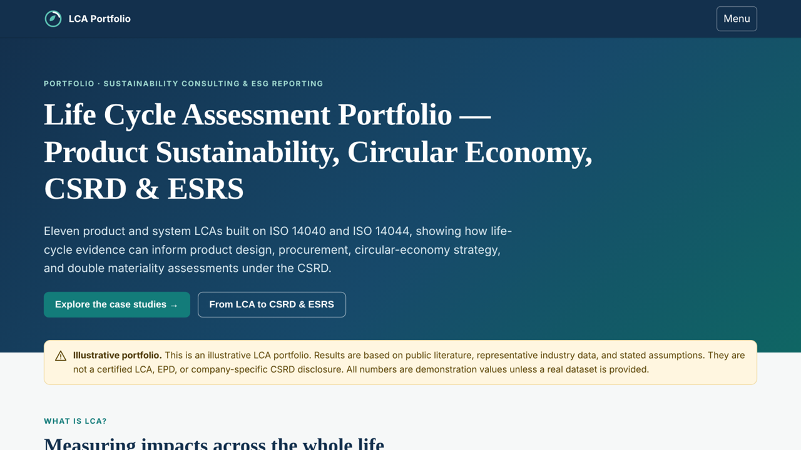
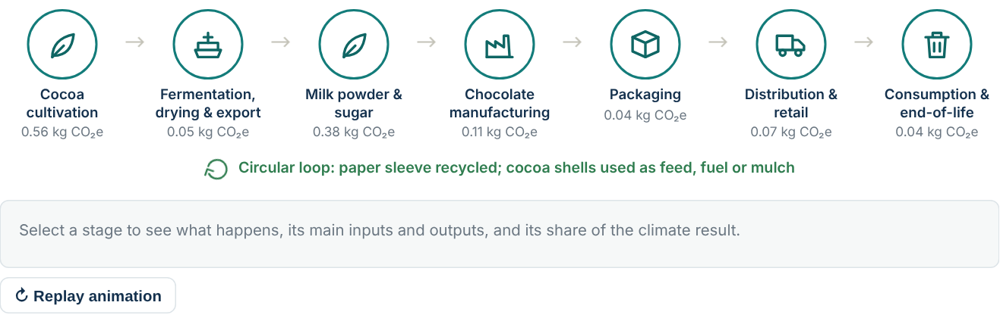
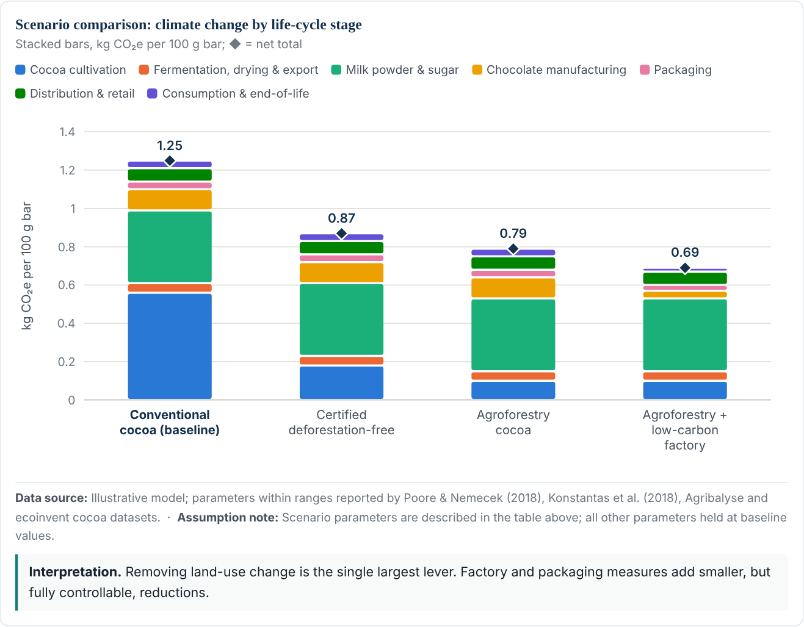
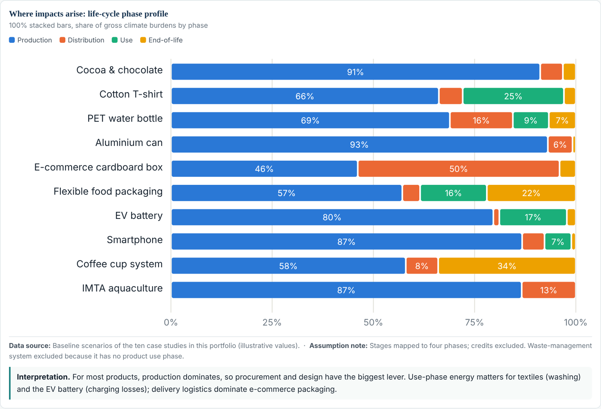

# Life Cycle Assessment Portfolio — Product Sustainability, Circular Economy, CSRD & ESRS

An interactive portfolio of **11 life cycle assessments** built on ISO 14040 and ISO 14044, showing how life-cycle evidence can inform product design, procurement, circular-economy strategy and CSRD/ESRS reporting.

**Live site:** `https://malleshkomal.github.io/malleshkomal/lca-portfolio/` (once GitHub Pages is enabled; see below)

> This is an illustrative LCA portfolio. Results are based on public literature, representative industry data, and stated assumptions. They are not a certified LCA, EPD, or company-specific CSRD disclosure. Cases 1–10 use demonstration values; case 11 re-uses published farm data from the INTEGRATE project.

## Case studies

| # | Product or system | Functional unit | Link |
|---|---|---|---|
| 1 | Cocoa and chocolate | One 100 g milk chocolate bar eaten | [#case-cocoa](https://malleshkomal.github.io/malleshkomal/lca-portfolio/#case-cocoa) |
| 2 | Cotton T-shirt | One T-shirt worn 50 times | [#case-tshirt](https://malleshkomal.github.io/malleshkomal/lca-portfolio/#case-tshirt) |
| 3 | PET water bottle (vs rPET, refillable glass, aluminium) | 500 ml delivered | [#case-pet](https://malleshkomal.github.io/malleshkomal/lca-portfolio/#case-pet) |
| 4 | Aluminium beverage can | One 330 ml can | [#case-can](https://malleshkomal.github.io/malleshkomal/lca-portfolio/#case-can) |
| 5 | E-commerce cardboard packaging | Packaging for one 1 kg order | [#case-box](https://malleshkomal.github.io/malleshkomal/lca-portfolio/#case-box) |
| 6 | Flexible food packaging | Pack for 250 g coffee | [#case-flex](https://malleshkomal.github.io/malleshkomal/lca-portfolio/#case-flex) |
| 7 | EV battery | One 60 kWh NMC811 pack | [#case-ev](https://malleshkomal.github.io/malleshkomal/lca-portfolio/#case-ev) |
| 8 | Smartphone | One year of use | [#case-phone](https://malleshkomal.github.io/malleshkomal/lca-portfolio/#case-phone) |
| 9 | Municipal plastic recycling system | 1 t waste managed | [#case-msw](https://malleshkomal.github.io/malleshkomal/lca-portfolio/#case-msw) |
| 10 | Coffee cups (single-use, compostable, reusable, ceramic) | One drink served | [#case-cup](https://malleshkomal.github.io/malleshkomal/lca-portfolio/#case-cup) |
| 11 | Integrated multi-trophic aquaculture (IMTA) | 1 t fish + oyster flesh | [#case-imta](https://malleshkomal.github.io/malleshkomal/lca-portfolio/#case-imta) |

Each case follows the same structure: goal and scope, life-cycle diagram, inventory, impact assessment, hotspots, scenarios, sensitivity, interpretation, recommendations, and an **LCA-to-ESRS mapping**. The site also has a methodology page (ISO 14040/14044), a CSRD/ESG/ESRS page, a cross-product comparison dashboard, circular-economy insights with a reuse break-even explorer, limitations, glossary and sources.

## Screenshots





<table><tr><td width="50%"></td><td width="50%"></td></tr></table>

## Folder contents

| Path | What it is |
|---|---|
| `index.html` | The complete website (one self-contained page) |
| `downloads/` | One-page summaries (PDF, 11 pages), all inventories (ZIP), one ZIP per inventory |
| `lci/` | Foreground inventories in the **LCIS2024** schema, one folder per case (see [`lci/README.md`](lci/README.md)) |
| `src/cases/*.json` | Case-study data and text |
| `src/template.html`, `src/build.py` | Site template and build script |
| `src/lci_specs.py`, `src/export_lci.py` | Inventory specifications and LCIS2024 exporter |
| `src/validate_lci.py` | Validation with [ptl-lci-explorer](https://github.com/malleshkomal/ptl-lci-explorer) `lcitools` |

## Life cycle inventories (LCIS2024)

All 11 inventories are published in the LCIS2024 schema (Nair, Chougule, Gomez Trillos & Brand-Daniels, 2025, *J. Cleaner Production* 520, 146120, [doi:10.1016/j.jclepro.2025.146120](https://doi.org/10.1016/j.jclepro.2025.146120)), in the same layout as the power-to-liquid example in ptl-lci-explorer: Brightway-layout CSV/XLSX, properties, filled metadata workbook, GraphML network and environment file. Every dataset passes `lcitools.validate.run_all` with 0 errors and reproduces the website's LCI tables when scaled to its functional unit.

## Rebuild

```bash
git clone https://github.com/malleshkomal/malleshkomal && git clone https://github.com/malleshkomal/ptl-lci-explorer
cd malleshkomal/lca-portfolio/src
export LCIS_TEMPLATE=../../../ptl-lci-explorer/data/original/metadata_template.xlsx LCITOOLS_SRC=../../../ptl-lci-explorer/src
python export_lci.py        # regenerates ../lci (needs LibreOffice for the metadata workbooks)
python validate_lci.py      # validates with lcitools
python build.py             # builds site_preview.html from template.html + cases/*.json
```
Set `LCIS_TEMPLATE` and `LCITOOLS_SRC` if ptl-lci-explorer is elsewhere.

## Live site (GitHub Pages)

The site is served from this folder by GitHub Pages for the `malleshkomal/malleshkomal` repository: Settings → Pages → Source **Deploy from a branch** → Branch **main**, folder **/ (root)**. It appears at `https://malleshkomal.github.io/malleshkomal/lca-portfolio/`. To view it offline, download the folder and open `index.html`.

## Related work

- Nair, R. R., Chougule, K. M., et al. (2025). A generalized schema to publish and share life cycle inventories (LCI). *Journal of Cleaner Production* 520, 146120.
- Hala, A. F., Chougule, K., et al. (2024). Life cycle assessment of integrated multi-trophic aquaculture: a review on methodology and challenges. *Aquaculture* 590, 741035.
- [IMTA LCA and KPI tool](https://github.com/malleshkomal/Life-cycle-assessment-of-Integrated-Multi-Trophical-Aquaculture-) (basis of case 11)

## Licence

Content and datasets: [CC BY 4.0](https://creativecommons.org/licenses/by/4.0/). Case 11 report data remain with the INTEGRATE partners (IPMA, CTAQUA).

**Author:** Komal Mallesh Chougule · prepared with AI assistance (Claude, Anthropic)
